# ซอมบี้ vs คนดู · คำสั่งเกม (Zombie vs Viewers commands)

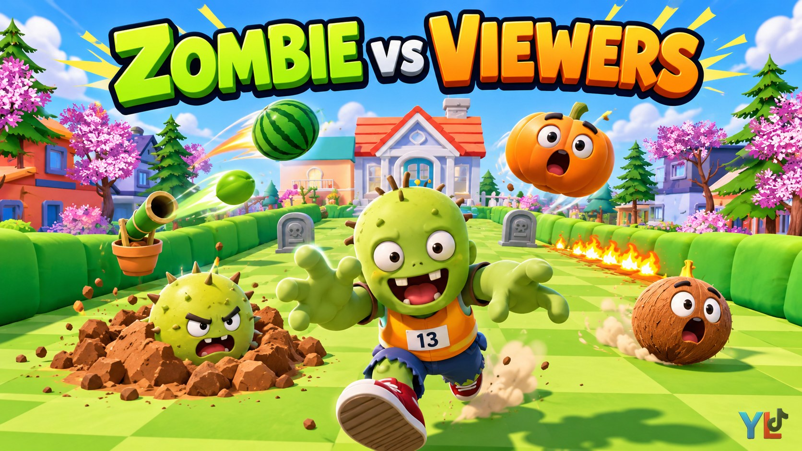

**เปิดหน้าเว็บคำสั่ง: https://aotgtr.github.io/zombie-commands/**

รายการคำสั่งทั้งหมดของเกม *ซอมบี้ vs คนดู* สำหรับตั้งของขวัญใน **YLTick** (กฎแบบ ของขวัญ → WebSocket) · แต่ละคำสั่งมีคลิปจากเกมจริง · ตัวเลขหลังคำสั่งบอกจำนวน/วินาที

## Helpers and pranks

Every command with a short clip from the game. Click a picture to play the clip. The number after a command is explained under each one.

### Helpers (ของช่วย)

> ของช่วยซอมบี้จะอัปเดตเพิ่มทีหลัง

<table>
<tr><td><a href="media/shoes.mp4">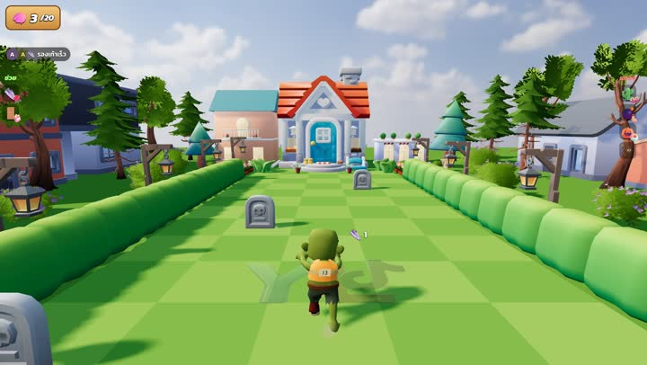</a></td><td><b>👟 รองเท้าเร็ว</b> <code>shoes</code></td><td>วิ่งเร็วขึ้น 3 วิ เลข = จำนวน ครั้งละ 3 วิ</td></tr>
<tr><td><a href="media/balloon.mp4">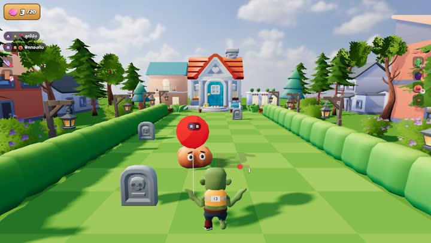</a></td><td><b>🎈 ลูกโป่ง</b> <code>balloon</code></td><td>พาลอยข้ามของแกล้งที่กำลังจะโดน 1 ชิ้น เลข = จำนวนครั้ง</td></tr>
<tr><td><a href="media/helmet.mp4">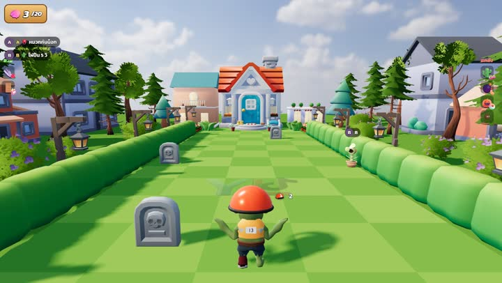</a></td><td><b>⛑️ หมวกกันน็อก</b> <code>helmet</code></td><td>กันของแกล้งได้ 3 ครั้งแล้วหลุด เลข = จำนวน ใบละ 3 ที</td></tr>
<tr><td><a href="media/skin_door.mp4">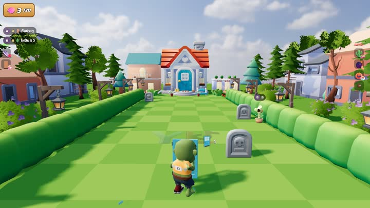</a></td><td><b>🚪 ถือประตู</b> <code>skin door</code></td><td>ถือประตูบังหน้า บานละรับของเบาได้ 3 ที ระเบิดกิน 1.5 เลข = จำนวนบาน</td></tr>
<tr><td><a href="media/pole.mp4">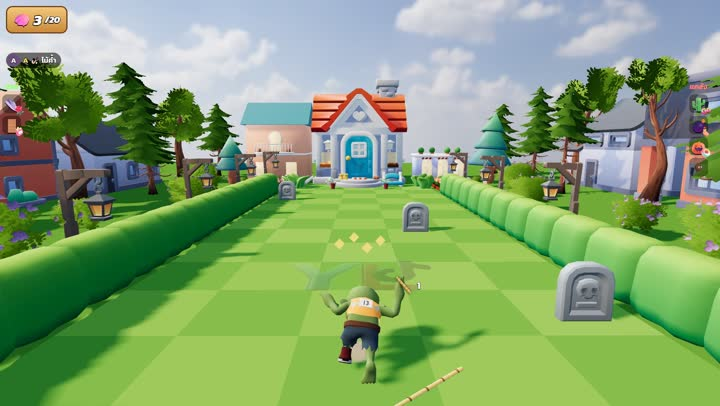</a></td><td><b>🏑 ไม้ค้ำ</b> <code>pole</code></td><td>กระโดดค้ำไม้ข้ามของแกล้งข้างหน้า เลข = จำนวน</td></tr>
<tr><td><a href="media/opendoor.mp4">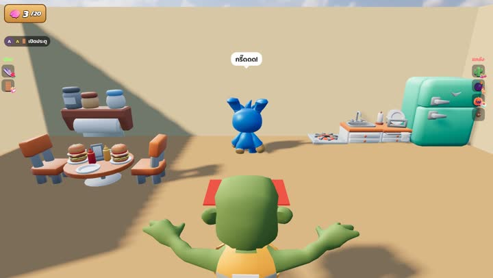</a></td><td><b>🚪 เปิดประตู</b> <code>opendoor</code></td><td>ประตูบ้านเปิดเอง ไม่ต้องเคาะ เลข = จำนวนรอบ</td></tr>
<tr><td><a href="media/skate.mp4">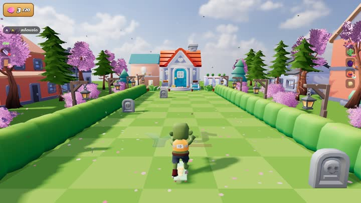</a></td><td><b>🛹 สเก็ตบอร์ด</b> <code>skate</code></td><td>สเก็ตบอร์ด วิ่งเร็วขึ้นเกือบ 2 เท่า 4 วิ เลข = จำนวน (ครั้งละ 4 วิ ซ้อนได้)</td></tr>
<tr><td><a href="media/jetpack.mp4">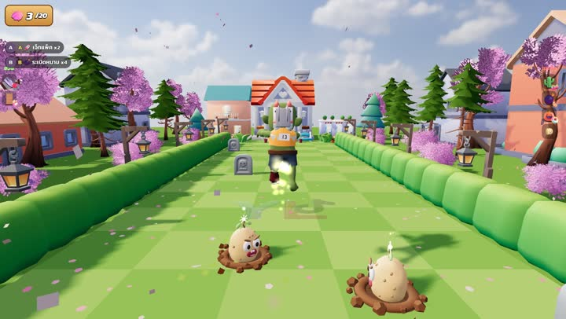</a></td><td><b>🚀 เจ็ทแพ็ค</b> <code>jetpack</code></td><td>เจ็ทแพ็คบินลอย ข้ามระเบิด กล้วย หมา ไฟ ของบนพื้นทั้งหมด เลข = จำนวน (ครั้งละ 3 วิ ซ้อนได้ เช่น 4 = 12 วิ)</td></tr>
<tr><td><a href="media/bubble.mp4">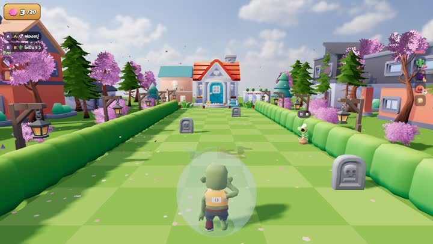</a></td><td><b>🫧 ฟองสบู่</b> <code>bubble</code></td><td>ฟองสบู่ครอบตัว กันได้ทุกทิศ ทุกอย่าง ลูกละ 2 ที เลข = จำนวนลูก (สูงสุด 5)</td></tr>
<tr><td><a href="media/spring.mp4">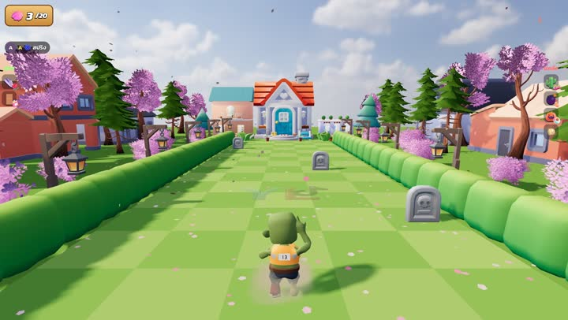</a></td><td><b>🌀 สปริง</b> <code>spring</code></td><td>สปริงโผล่ใต้เท้า เด้งลอยไปข้างหน้า 3 ม. เลข = จำนวนครั้ง</td></tr>
</table>

### Pranks (ของแกล้ง)

<table>
<tr><td><a href="media/shooter.mp4">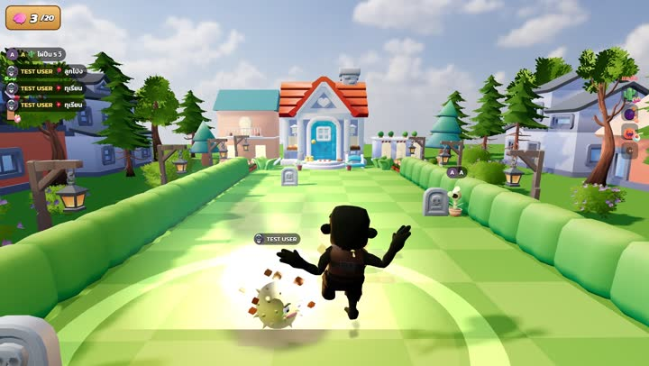</a></td><td><b>🌵 ไผ่ปืน</b> <code>shooter</code></td><td>ไผ่ปืนใหญ่โผล่ข้างสนาม ยิงดักทางทุก 2 วิ เลข = วินาที (ไม่ใส่ = 5)</td></tr>
<tr><td><a href="media/burst.mp4">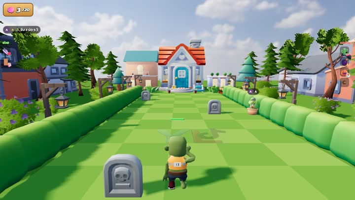</a></td><td><b>🎋 ยิง 3 นัด</b> <code>burst</code></td><td>หน่อไม้ปืนกล ยิงชุดละ 3 นัด เลข = วินาที (ไม่ใส่ = 5)</td></tr>
<tr><td><a href="media/lobber.mp4">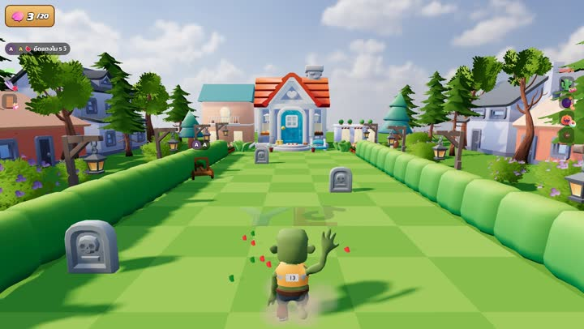</a></td><td><b>🍉 ดีดแตงโม</b> <code>lobber</code></td><td>เครื่องดีดแตงโมโค้งดักทาง เลข = วินาที (ไม่ใส่ = 5)</td></tr>
<tr><td><a href="media/iceshooter.mp4">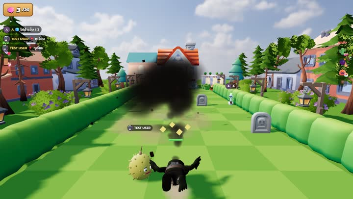</a></td><td><b>🧊 ไผ่น้ำแข็ง</b> <code>iceshooter</code></td><td>ไผ่ปืนน้ำแข็ง โดนแล้วช้าลง 1.2 วิ เลข = วินาที (ไม่ใส่ = 5)</td></tr>
<tr><td><a href="media/mine.mp4">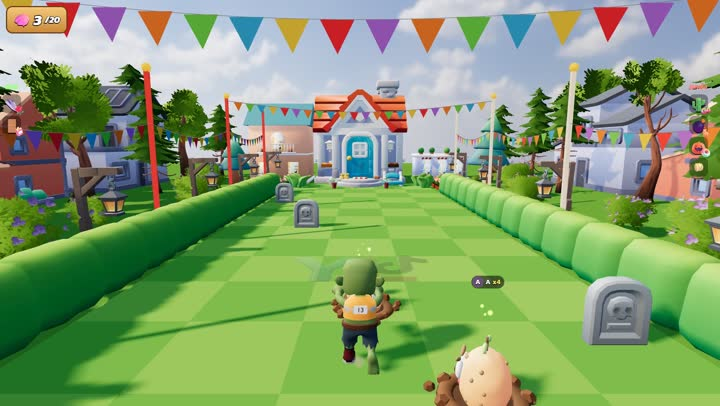</a></td><td><b>💣 ระเบิดหนาม</b> <code>mine</code></td><td>ระเบิดหนามลูกเล็กฝังจมดินทั่วสวน อยู่จนกว่าจะเหยียบ · พร้อมเมื่อไหร่กระพริบแดง ชนวนมีประกาย เลข = จำนวนลูก (x500 ได้ เต็มสวน)</td></tr>
<tr><td><a href="media/jumper.mp4">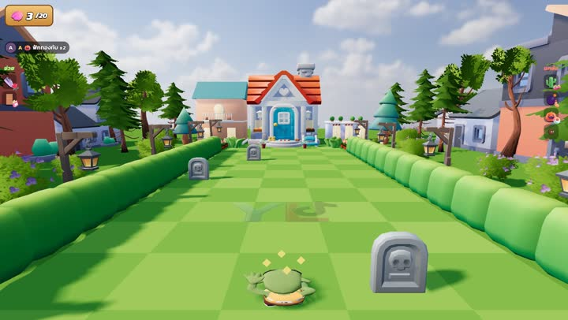</a></td><td><b>🎃 ฟักทองทับ</b> <code>jumper</code></td><td>ฟักทองรอในสวน เข้าใกล้แล้วโดดขึ้น เล็งตามกลางอากาศ แล้วกระแทกลงเร็ว เลข = จำนวน</td></tr>
<tr><td><a href="media/nut.mp4">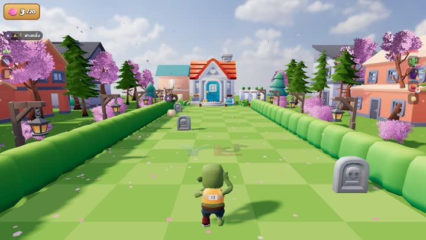</a></td><td><b>🌾 ฟางกลิ้ง</b> <code>nut</code></td><td>มะพร้าวกลิ้งออกจากประตูบ้าน ลูกเล็ก/ใหญ่สุ่ม หน้าหมุนตามลูก เลข = จำนวนลูก (มาเป็นฝูง)</td></tr>
<tr><td><a href="media/pitcher.mp4">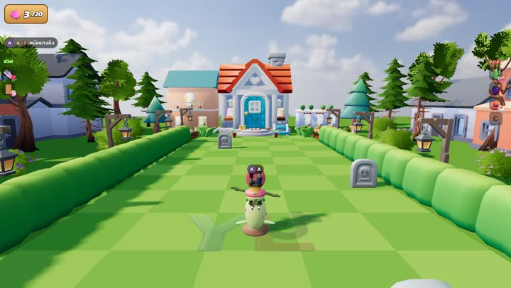</a></td><td><b>🏺 หม้อแกงลิง</b> <code>pitcher</code></td><td>หม้อแกงลิงยืดตัวงับจากระยะ 1.8 ม. เคี้ยว แล้วพ่นขึ้นฟ้าเหมือนจรวด ตกไกลไปข้างหลัง เลข = จำนวน</td></tr>
<tr><td><a href="media/durian.mp4">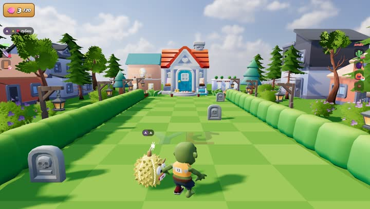</a></td><td><b>💥 ทุเรียน</b> <code>durian</code></td><td>ทุเรียนเหลืองโผล่ข้างตัว รอยแตกเรืองส้ม ชนวนไหม้ แล้วระเบิดลูกใหญ่ เลข = จำนวน</td></tr>
<tr><td><a href="media/chili.mp4">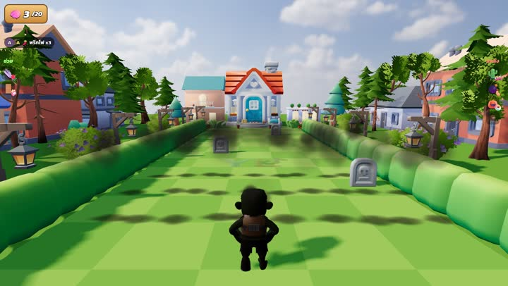</a></td><td><b>🌶️ พริกไฟ</b> <code>chili</code></td><td>ไฟพริกลุกเป็นแนวขวางสนาม จอสั่น ยิ่งหลายลูกพร้อมกันยิ่งแรง เลข = จำนวน (x3 = ไฟ 3 แนว)</td></tr>
<tr><td><a href="media/sprinkler.mp4">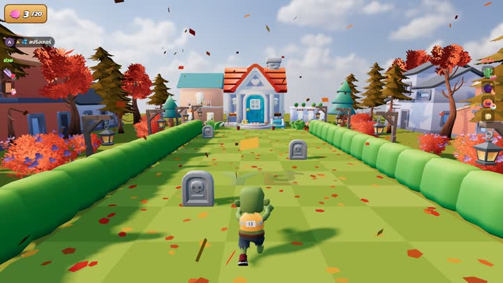</a></td><td><b>💦 สปริงเกอร์</b> <code>sprinkler</code></td><td>สปริงเกอร์ดอกไม้ พื้นรอบๆ เปียก เดินเข้าไปแล้วลื่นล้ม ไถลไปทิศสุ่ม เลข = จำนวน</td></tr>
<tr><td><a href="media/mower.mp4">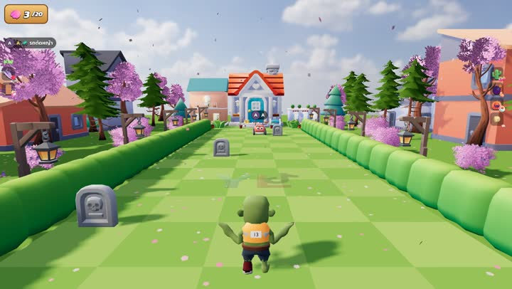</a></td><td><b>🚜 รถตัดหญ้า</b> <code>mower</code></td><td>รถตัดหญ้าวิ่งออกจากประตูบ้าน ชนแล้วกระเด็น เลข = จำนวนคัน</td></tr>
<tr><td><a href="media/banana.mp4">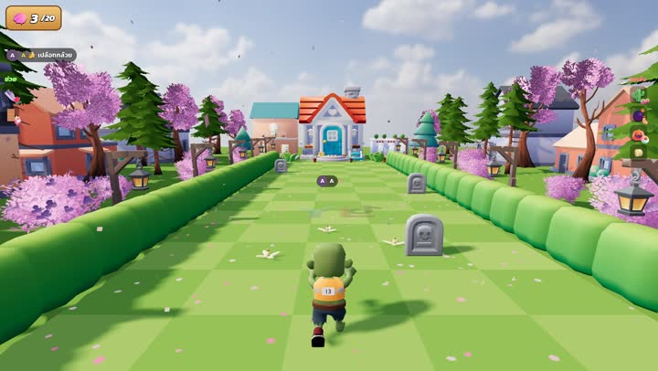</a></td><td><b>🍌 เปลือกกล้วย</b> <code>banana</code></td><td>เปลือกกล้วย 4 ชิ้นโปรยตามทาง เหยียบแล้วลื่นล้ม เลข = จำนวน (ชุดละ 4 ชิ้น)</td></tr>
<tr><td><a href="media/dog.mp4">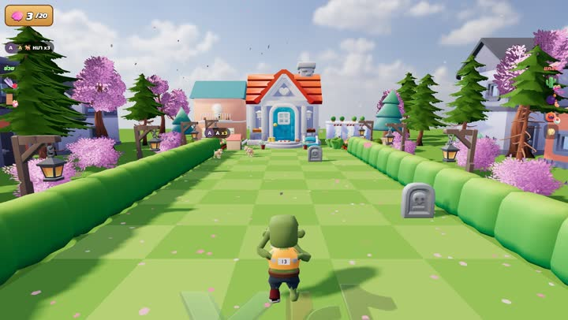</a></td><td><b>🐕 หมา</b> <code>dog</code></td><td>บ้านหมาโผล่หลังสวน หมาวิ่งออกมาวิ่งมั่ว เห็นแล้วงับขาลากถอยหลัง เลข = จำนวนหมา</td></tr>
<tr><td><a href="media/lightning.mp4">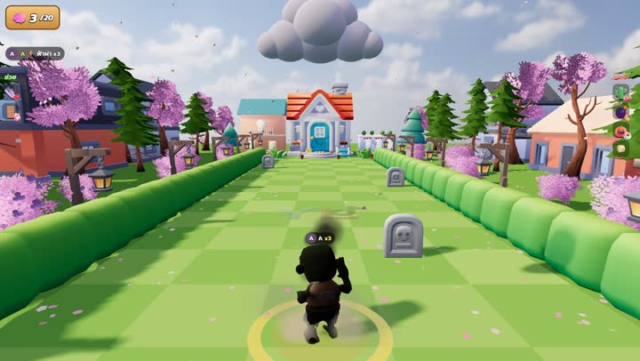</a></td><td><b>⚡ ฟ้าผ่า</b> <code>lightning</code></td><td>เมฆลอยตามหัว วงเหลืองขึ้นตรงที่ยืน แล้วฟ้าผ่าลงจุดนั้น เลข = จำนวนรอบที่ผ่า (สูงสุด 10)</td></tr>
<tr><td><a href="media/nuke.mp4">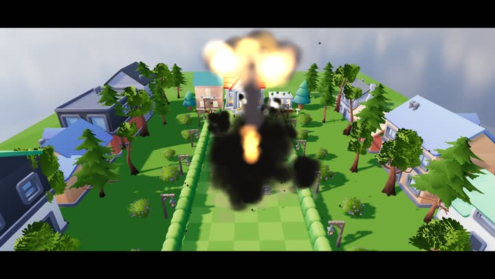</a></td><td><b>🍄 เห็ดดำบึ้ม</b> <code>nuke</code></td><td>คัทซีนเห็ดดำ: บึ้มทั้งแมพ ตายทันที สมอง −1 เลข = จำนวนครั้ง (สูงสุด 5)</td></tr>
</table>

`brain n` / `brain -n` adds or removes brains. Levels 1-21 are shown in one clip: [media/levels.mp4](media/levels.mp4).

